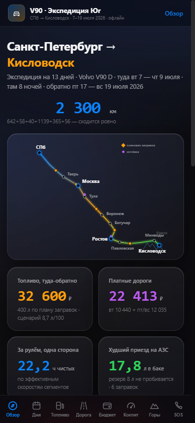
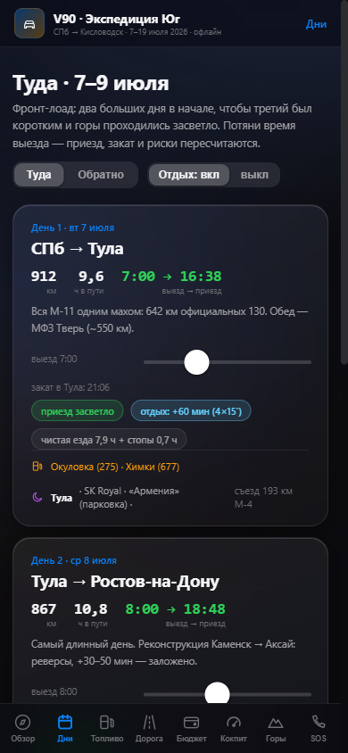
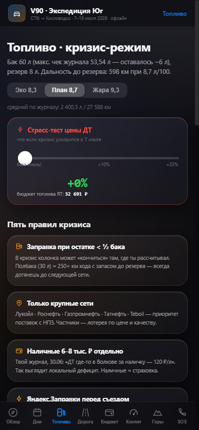
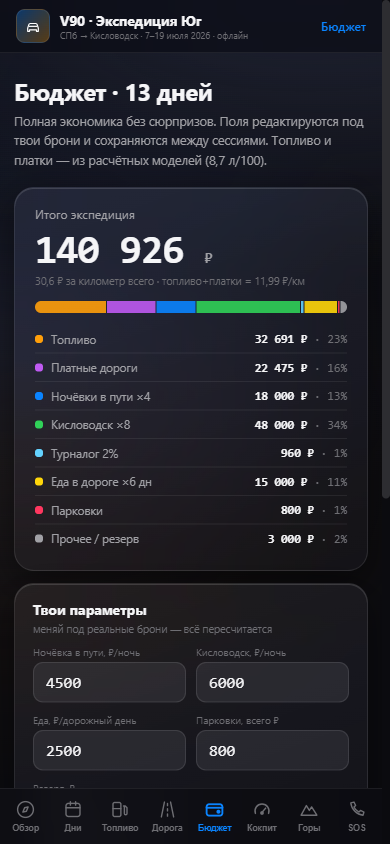
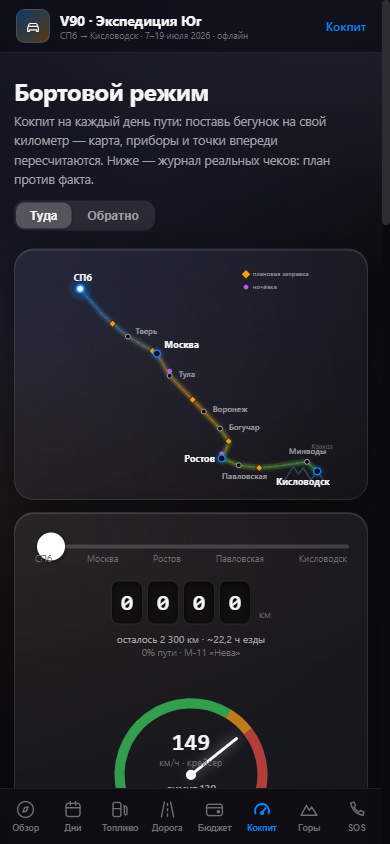

# Road Trip Dashboard — a phone "mini app" in a single HTML file

**[▶ Live demo](https://daniildisa.github.io/roadtrip-dashboard/)** (best viewed on a phone or in mobile view; UI in Russian)

**The idea:** you don't always need an App Store app, a backend or a team to get a useful app on your phone. This is a full interactive app — 8 screens, charts, calculations, saved data — packed into **one HTML file**. Download it to an iPhone, add a home-screen icon via the **Shortcuts** app that opens the file in a browser (e.g. Microsoft Edge), and it behaves like a native mini app: launches from its own icon, **works fully offline and locally**, keeps your data on the device.

No App Store review, no hosting, no servers, no subscriptions — and a fraction of the cost and time of native development.

| Overview | Days | Fuel | Budget | Cockpit |
|---|---|---|---|---|
|  |  |  |  |  |

## The real use case

I built it to plan and run a real road trip: **St. Petersburg → Kislovodsk and back, 2,300 km each way, July 2026** — and used it on the road, often without mobile signal. It turns a messy pile of numbers (fuel, tolls, hotels, sunsets, prices) into one cockpit:

- **Route model** — 6 road segments with their own effective speeds (calibrated on real trip times), elevation profile, toll operators and tariffs.
- **Day planner** — a departure-time slider recalculates arrival time, rest stops and whether you arrive **before sunset** for every stage.
- **Fuel model** — consumption scenarios (eco / plan / heat with A/C) based on a real fuel log of 64 receipts; planned refuelling points with a reserve check; a **diesel price stress-test** that propagates through every tab.
- **Budget** — full trip economics (fuel, tolls, hotels, tourist tax, food, parking, reserve) with editable inputs and a "what if we flew instead?" comparison.
- **Cockpit mode** — drag a slider to your current kilometre: map position, gauges, distance to the next fuel stop and upcoming points recalculate; a receipt log compares plan vs. actual.
- **SOS page** — emergency numbers and personal fields saved locally.
- **Data safety** — state is saved in local storage, with backup/restore through the share sheet.

## Install it on an iPhone

1. Download [`index.html`](index.html) and save it to the **Files** app.
2. In the **Shortcuts** app, create a shortcut that opens this file in a browser (e.g. **Microsoft Edge**).
3. Add the shortcut to the **Home Screen** with your own icon and name.

That's it — a home-screen app that works offline. (Alternatively, open the live demo in Safari → Share → *Add to Home Screen*.)

## Why this approach is worth it

| | Native app | Single-file mini app |
|---|---|---|
| Time to build | weeks–months | days |
| App Store / Google Play | review, developer account | not needed |
| Backend & hosting | usually required | none — runs locally |
| Works offline | depends | always |
| Updating | new release & review | replace one file |

Good fit for personal and small-business tools: calculators, checklists, planners, field-work forms, price lists, dashboards over your own data.

## Tech

- React + Recharts, bundled into **one self-contained HTML file** (all code, styles and icons inline)
- Mobile-first UI: home-screen mode, safe-area insets, dark theme, touch-friendly controls
- Data viz: SVG route map, elevation profile, fuel and cost charts, speed gauge
- Persistence in `localStorage`, export/import backup as text

## Author

**Daniil Burnashov**
